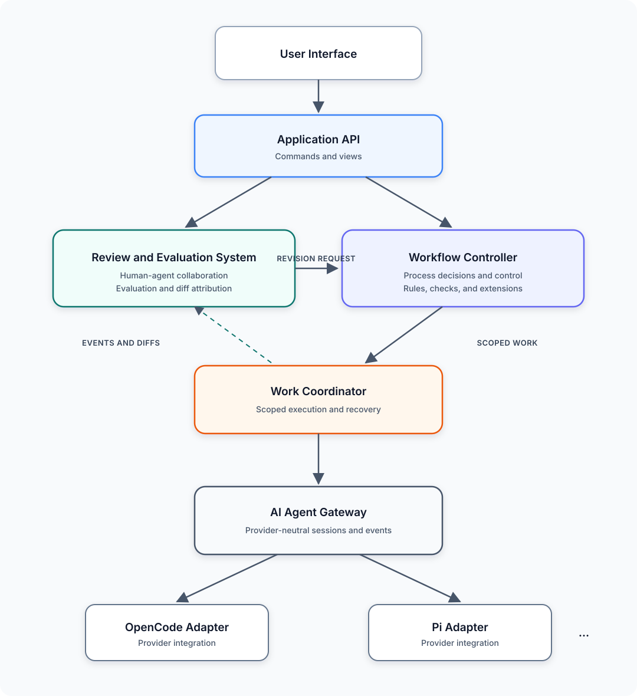

# Daoji overall architecture

Document type: Architecture design

Purpose: Define Daoji's top-level components, their responsibilities, and their
collaboration boundaries.

Audience: People and agents that design, implement, review, or integrate Daoji.

Scope: This design defines the logical system architecture. It does not define
detailed workflows, hook contracts, check formats, session protocols, diff
algorithms, storage schemas, user-interface technology, or deployment topology.

## Summary

Daoji coordinates document-defined development through two primary application
capabilities. The **Workflow Controller** decides and controls the development
process. The **Review and Evaluation System** supports collaboration between
people and AI agents by explaining, evaluating, attributing, and revising agent
work. The Workflow Controller uses the **Work Coordinator** to execute bounded
work through a provider-neutral **AI Agent Gateway**. The Review and Evaluation
System observes that work and submits revision requests through the controller.

The architecture starts as a modular monolith under the authoritative
[initial Rust architecture](0001-initial-rust-architecture.md). The components
in this design are logical boundaries. This design does not require a crate,
process, service, or deployment unit for each component.

## System architecture

The diagram shows the primary control relationships, not every data dependency.
The Application API is the entry point for user-facing operations. The Workflow
Controller and Review and Evaluation System collaborate through explicit
application contracts. The controller submits executable work through the Work
Coordinator. The AI Agent Gateway isolates the rest of Daoji from
provider-specific agent interfaces.

## Architectural principles

The architecture follows these principles:

1. **Repository-derived authority.** Candidate assets become authoritative only
   when an authorized merge places them in the protected authoritative branch.
2. **Controlled AI decisions.** AI can assess, recommend, explain, and evaluate.
   Daoji must apply applicable workflow rules, project policies, checks, and
   repository governance before acting on an AI result.
3. **Human-visible work.** People must be able to inspect what an agent produced,
   why it produced it, and how each action changed the candidate repository.
4. **Scoped execution.** Every agent action runs through a bounded task with
   explicit context, permissions, expected outputs, and completion criteria.
5. **Provider neutrality.** Application components do not depend on OpenCode,
   Pi, or another provider-specific interface.
6. **Extensible validation.** Projects can add checks without embedding project-
   specific behavior in the Daoji core.
7. **Explicit provenance.** Workflow decisions, agent actions, comments,
   evaluations, and repository changes remain traceable to their inputs.

## Components

### User interface

The User Interface (UI) presents projects, change proposals, workflow progress,
agent activity, diffs, evaluations, comments, checks, and repository-governance
state. It lets people submit requests, inspect candidate assets, comment on agent
work, request revisions, and review merge readiness.

The UI contains no workflow, evaluation, or provider policy. It uses the
Application API so that a TUI, web interface, or native client can expose the
same application capabilities.

### Application API

The Application API is the stable boundary between user interfaces and Daoji's
application components. It exposes commands and views for workflow operations,
review, evaluation, comments, agent work, and project state.

The API authenticates and translates requests at the application boundary, but
it does not decide workflow transitions or evaluate agent output. Public API
formats and transport protocols require separate designs.

### Workflow Controller

The Workflow Controller decides and controls the development process for a
change proposal. It owns the change entry's workflow state and determines the
next permitted work.

Its responsibilities include:

- Assessing a request and selecting the applicable development path.
- Determining which engineering assets and workflow stages are required.
- Deciding whether a stage can be omitted or combined.
- Checking whether prior outputs satisfy governing documents and applicable
  project rules.
- Coordinating built-in, project-defined, automated, AI-assisted, and human
  checks.
- Creating bounded work requests for the Work Coordinator.
- Returning work to an earlier stage when evidence invalidates an assumption.

The Workflow Controller may use AI to assess complexity, recommend workflow
tailoring, or evaluate material that deterministic rules cannot fully assess.
An AI result remains an input to a workflow decision. The controller must not
let an AI result bypass authoritative permissions, mandatory repository checks,
or unresolved blocking decisions.

Projects can extend workflow evaluation through hooks or an equivalent check
extension boundary. This overall design requires the extension boundary but
does not select its event model, process model, configuration format, security
model, or result schema.

### Review and Evaluation System

The Review and Evaluation System is the primary collaboration boundary between
people and AI agents. It helps a person understand agent work, evaluates that
work against project context, generates AI-assisted suggestions, records human
comments, and turns accepted feedback into revision requests.

Its responsibilities include:

- Presenting agent actions, outputs, explanations, and candidate changes.
- Associating comments and evaluations with tasks, actions, assets, source
  locations, and Git revisions.
- Using AI to summarize changes, explain reasoning, identify risks, and suggest
  review comments or revisions.
- Accepting human comments and requesting corresponding agent-assisted changes.
- Tracking the relationship between a comment, the resulting agent actions, and
  the resulting diff.
- Distinguishing repository facts, deterministic findings, AI evaluations, and
  human decisions.

The system interposes on agent sessions through the execution path so it can
observe context and actions and can support continued human-agent collaboration.
It also uses version-control capabilities to calculate the current agent diff,
per-action diffs, and diffs associated with comments and subsequent revisions.

This design does not decide whether interposition uses event subscription,
session mediation, checkpoints, worktrees, commits, trees, blobs, patches, or
another mechanism. Those choices require a separate design that addresses
concurrency, attribution accuracy, recovery, privacy, and provider capability.

The Review and Evaluation System does not authorize merge and does not directly
bypass workflow control. A human revision request returns to the Workflow
Controller, which determines the required work and checks.

### Work Coordinator

The Work Coordinator executes bounded work requested by the Workflow Controller.
It separates workflow and review decisions from execution mechanics.

Its responsibilities include:

- Receiving scoped work requests from the Workflow Controller.
- Preparing the required project context and execution environment.
- Selecting an agent interface with the required capabilities.
- Starting, resuming, cancelling, and recovering agent work.
- Enforcing task permissions and execution limits.
- Collecting normalized events, outputs, failures, and work results.
- Making execution information available to the Workflow Controller and Review
  and Evaluation System.

The Work Coordinator does not decide which lifecycle stages are required and
does not determine whether human comments are resolved.

### AI Agent Gateway

The AI Agent Gateway provides the provider-neutral interface for AI agent work.
It translates common Daoji task, context, permission, session, event,
cancellation, and result concepts to provider-specific adapters.

The gateway preserves provider capabilities rather than forcing every provider
into the least-capable common model. A work request must fail visibly when the
selected provider cannot satisfy a required capability or control.

Session management, context reuse, cache affinity, event normalization, and
provider recovery belong behind this boundary. Their exact contracts and
algorithms remain deferred.

### AI agent adapters

Each AI agent adapter integrates one provider or agent tool, such as OpenCode or
Pi. An adapter maps provider authentication, capabilities, sessions, tools,
permissions, events, cancellation, errors, and results to the AI Agent Gateway.

Provider-specific behavior must not leak into the Workflow Controller, Review
and Evaluation System, or Work Coordinator.

## Shared system boundaries

The application components require shared access to the authoritative project
record, candidate repository snapshot, version-control operations, evidence,
and repository-governance state. These are infrastructure boundaries rather
than additional owners of workflow or review decisions.

- The **project record boundary** supplies engineering assets, typed
  relationships, change-entry workflow state, and evidence references.
- The **version-control boundary** supplies Git commit, tree, blob, changed-path,
  and diff capabilities needed for snapshots and attribution.
- The **repository-governance boundary** supplies required path reviews,
  mandatory checks, branch protection, merge eligibility, and merge results.
- The **evidence boundary** retains execution, validation, and evaluation
  evidence under applicable project policy.

Detailed contracts for these boundaries remain separate design work.

## Main collaboration flows

### Develop a change

1. The UI submits a request through the Application API.
2. The Workflow Controller assesses the request and selects the required stages
   and candidate assets.
3. The Workflow Controller submits bounded work to the Work Coordinator.
4. The Work Coordinator executes the task through the AI Agent Gateway and an
   applicable provider adapter.
5. Results return to the Workflow Controller for further workflow decisions and
   to the Review and Evaluation System for human-visible inspection.

### Review and revise agent work

1. The Review and Evaluation System observes agent activity and calculates the
   applicable repository diffs.
2. It presents facts, evaluations, AI-assisted suggestions, and unresolved
   findings through the Application API.
3. A person comments on or requests a revision to a specific piece of work.
4. The Review and Evaluation System submits the revision request to the Workflow
   Controller.
5. The controller determines the required tasks and checks, then uses the Work
   Coordinator to execute the revision.
6. The review system associates the resulting actions and diffs with the
   original comment.

## Trust and authority boundaries

- AI output and AI-assisted evaluations are untrusted inputs until applicable
  checks evaluate them.
- Project-defined hooks cannot silently override authoritative project rules or
  mandatory repository checks.
- Review explanations and suggestions must remain distinguishable from actual
  repository changes and deterministic findings.
- Agent sessions cannot become an authoritative store of project decisions.
- The PR head Git commit identifies the candidate repository revision reviewed
  by required path owners and mandatory checks.
- Only an authorized merge updates the authoritative branch.

## Deferred decisions

This design intentionally defers:

- The workflow stage model and tailoring algorithm.
- The hook and custom-check API, runtime, permissions, and result format.
- Which AI evaluations can participate in automated workflow gates.
- The Application API transport and schema.
- Session interposition, continuation, context, and caching protocols.
- Agent event and work-result formats.
- Diff attribution, checkpoint, worktree, and concurrency mechanisms.
- Comment, evaluation, and revision-request schemas.
- Storage, evidence retention, and recovery mechanisms.
- User-interface and deployment technologies.

Each deferred subject requires requirements, alternatives, failure behavior,
security assumptions, and verification criteria before implementation.

## References

- [Daoji project charter](../PROJECT_CHARTER.md)
- [Daoji development lifecycle standard](../standards/DEVELOPMENT_LIFECYCLE_STANDARD.md)
- [Initial Rust architecture](0001-initial-rust-architecture.md)
- [Daoji README](../../README.md)
