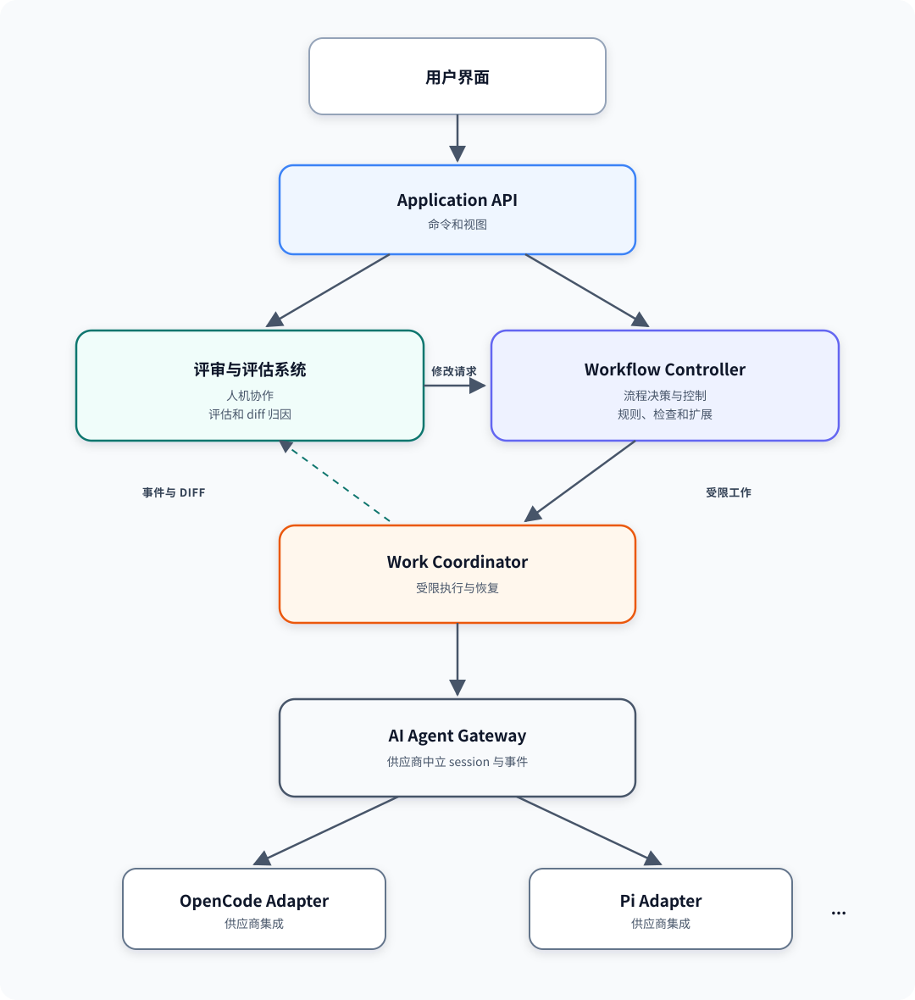

# Daoji 总体架构

> 本文档是非权威的简体中文翻译。请参阅[英文原文](../../../design/0002-overall-architecture.md)；如有语义冲突，以英文原文为准。

文档类型：架构设计

目的：定义 Daoji 的顶层组件、组件职责和协作边界。

受众：设计、实施、评审或集成 Daoji 的人员和智能体。

范围：本设计定义逻辑系统架构，不定义具体工作流、hook 契约、检查格式、session 协议、diff 算法、存储模式、用户界面技术或部署拓扑。

## 摘要

Daoji 通过两项主要应用能力协调文档定义的开发。**Workflow Controller** 决定并控制开发流程，并通过 **Work Coordinator** 提交受限工作，再由供应商中立的 **AI Agent Gateway** 执行。**Review and Evaluation System** 通过解释、评估、归因和修改智能体工作，支持人员与 AI 智能体协作；它观察这些工作，并通过 Workflow Controller 提交修改请求。

Daoji 根据权威的[初始 Rust 架构](0001-initial-rust-architecture.md)，以模块化单体开始。本文组件是逻辑边界，不要求每个组件分别成为 crate、进程、服务或部署单元。

## 系统架构

图中展示主要控制关系，而不是全部数据依赖。Application API 是面向用户操作的入口。Workflow Controller 与 Review and Evaluation System 通过明确的应用契约协作。Workflow Controller 通过 Work Coordinator 提交可执行工作。AI Agent Gateway 将 Daoji 其它部分与供应商特定接口隔离。

## 架构原则

1. **权威性来自仓库。** 只有获得授权的合并把候选资产放入受保护权威分支后，候选资产才具有权威性。
2. **受控的 AI 决策。** AI 可以评估、建议、解释和审查。Daoji 在执行 AI 结果前必须应用工作流规则、项目政策、检查和仓库治理。
3. **工作对人员可见。** 人员必须能够检查智能体生成了什么、为何生成，以及每次行动如何改变候选仓库。
4. **受限执行。** 每次智能体行动都通过具有明确上下文、权限、预期输出和完成标准的受限任务执行。
5. **供应商中立。** 应用组件不依赖 OpenCode、Pi 或其它供应商特定接口。
6. **可扩展验证。** 项目可以增加检查，而无需把项目特定行为嵌入 Daoji 核心。
7. **明确来源。** 工作流决策、智能体行动、评论、评估和仓库变更都可追溯到输入。

## 组件

### 用户界面

用户界面（UI）呈现项目、变更提案、工作流进度、智能体活动、diff、评估、评论、检查和仓库治理状态。人员可以提交请求、检查候选资产、评论智能体工作、请求修改并审查合并就绪状态。

UI 不包含工作流、评估或供应商政策。它使用 Application API，使 TUI、Web 或原生客户端可以公开相同应用能力。

### Application API

Application API 是用户界面和 Daoji 应用组件之间的稳定边界。它公开工作流操作、评审、评估、评论、智能体工作和项目状态的命令与视图。

API 在应用边界验证并转换请求，但不决定工作流转换，也不评估智能体输出。公共 API 格式和传输协议需要单独设计。

### Workflow Controller

Workflow Controller 决定并控制变更提案的开发流程。它保存变更条目的工作流状态，并确定下一项允许的工作。

其职责包括：

- 评估请求并选择适用开发路径。
- 确定必需的工程资产和工作流阶段。
- 决定阶段是否可以省略或合并。
- 检查先前输出是否符合治理文档和项目规则。
- 协调内置、项目定义、自动化、AI 辅助和人员检查。
- 为 Work Coordinator 创建受限工作请求。
- 当证据推翻假设时返回更早阶段。

Workflow Controller 可以使用 AI 评估复杂度、建议流程裁剪或评估确定性规则无法充分判断的材料。AI 结果仍只是工作流决策的输入，不能绕过权威权限、仓库强制检查或尚未解决的阻塞决策。

项目可以通过 hook 或等价检查扩展边界扩展工作流评估。总体设计只要求存在扩展边界，不选择事件模型、进程模型、配置格式、安全模型或结果模式。

### Review and Evaluation System

Review and Evaluation System 是人员与 AI 智能体之间的主要协作边界。它帮助人员理解智能体工作、根据项目上下文进行评估、生成 AI 辅助建议、记录人员评论，并把反馈转换为修改请求。

其职责包括：

- 呈现智能体行动、输出、解释和候选变更。
- 将评论和评估关联到任务、行动、资产、源码位置和 Git 修订。
- 使用 AI 总结变更、解释原因、识别风险并建议评论或修改。
- 接受人员评论并请求对应的智能体辅助修改。
- 跟踪评论、后续智能体行动和结果 diff 之间的关系。
- 区分仓库事实、确定性发现、AI 评估和人员决策。

该系统在执行路径中对智能体 session 进行中介，以观察上下文和行动并支持持续的人机协作。它还通过版本控制能力计算当前智能体 diff、每次行动的 diff，以及与评论和后续修改相关的 diff。

本设计不决定中介机制使用事件订阅、session mediation、检查点、worktree、commit、tree、blob、patch 或其它方式。这些选择需要后续设计处理并发、归因准确性、恢复、隐私和供应商能力。

Review and Evaluation System 不授权合并，也不绕过工作流控制。人员修改请求返回 Workflow Controller，由后者决定必需工作和检查。

### Work Coordinator

Work Coordinator 执行 Workflow Controller 请求的受限工作，将工作流和评审决策与执行机制分离。

其职责包括：

- 接收 Workflow Controller 的受限工作请求。
- 准备项目上下文和执行环境。
- 选择具备所需能力的智能体接口。
- 启动、恢复、取消和恢复智能体工作。
- 执行任务权限和执行限制。
- 收集规范化事件、输出、失败和工作结果。
- 向 Workflow Controller 和 Review and Evaluation System 提供执行信息。

Work Coordinator 不决定需要哪些生命周期阶段，也不判断人员评论是否已解决。

### AI Agent Gateway

AI Agent Gateway 提供 AI 智能体工作的供应商中立接口。它把 Daoji 通用的任务、上下文、权限、session、事件、取消和结果概念转换到供应商适配器。

Gateway 保留供应商能力差异，而不是把所有供应商压缩到能力最弱的公共模型。当所选供应商不能满足必要能力或控制时，工作请求必须明确失败。

Session 管理、上下文复用、缓存亲和性、事件规范化和供应商恢复位于此边界之后。具体契约和算法留给后续设计。

### AI 智能体适配器

每个适配器集成一个供应商或智能体工具，例如 OpenCode 或 Pi。适配器把供应商身份验证、能力、session、工具、权限、事件、取消、错误和结果映射到 AI Agent Gateway。

供应商特定行为不得泄漏到 Workflow Controller、Review and Evaluation System 或 Work Coordinator。

## 共享系统边界

应用组件需要共同访问权威项目记录、候选仓库快照、版本控制操作、证据和仓库治理状态。这些是基础设施边界，不拥有工作流或评审决策。

- **项目记录边界**提供工程资产、类型化关系、变更条目工作流状态和证据引用。
- **版本控制边界**提供快照和归因所需的 Git commit、tree、blob、变更路径和 diff 能力。
- **仓库治理边界**提供必需路径评审、强制检查、分支保护、合并资格和合并结果。
- **证据边界**依据适用项目政策保留执行、验证和评估证据。

这些边界的具体契约属于后续设计。

## 主要协作流程

### 开发变更

1. UI 通过 Application API 提交请求。
2. Workflow Controller 评估请求，并选择必需阶段和候选资产。
3. Workflow Controller 向 Work Coordinator 提交受限工作。
4. Work Coordinator 通过 AI Agent Gateway 和适用供应商适配器执行任务。
5. 结果返回 Workflow Controller 供后续流程决策，并返回 Review and Evaluation System 供人员检查。

### 评审和修改智能体工作

1. Review and Evaluation System 观察智能体活动并计算适用仓库 diff。
2. 它通过 Application API 呈现事实、评估、AI 辅助建议和未解决发现。
3. 人员针对具体工作评论或请求修改。
4. Review and Evaluation System 把修改请求提交给 Workflow Controller。
5. Controller 决定必需任务和检查，并通过 Work Coordinator 执行修改。
6. Review System 将结果行动和 diff 与原始评论关联。

## 信任和权威边界

- AI 输出和 AI 辅助评估在通过适用检查前是不可信输入。
- 项目定义 hook 不能静默覆盖权威项目规则或仓库强制检查。
- 评审解释和建议必须与实际仓库变更及确定性发现保持可区分。
- 智能体 session 不能成为项目决策的权威存储。
- PR head Git commit 标识必需路径评审者和强制检查所评审的候选仓库修订。
- 只有获得授权的合并才能更新权威分支。

## 延后决策

- 工作流阶段模型和裁剪算法。
- Hook 和自定义检查 API、运行时、权限及结果格式。
- 哪些 AI 评估可以参与自动化工作流门禁。
- Application API 传输和模式。
- Session 中介、续接、上下文和缓存协议。
- 智能体事件和工作结果格式。
- Diff 归因、检查点、worktree 和并发机制。
- 评论、评估和修改请求模式。
- 存储、证据保留和恢复机制。
- 用户界面和部署技术。

每项延后主题在实施前都需要需求、替代方案、失败行为、安全假设和验证标准。

## 参考资料

- [Daoji 项目章程](../PROJECT_CHARTER.md)
- [Daoji 开发生命周期标准](../standards/DEVELOPMENT_LIFECYCLE_STANDARD.md)
- [初始 Rust 架构](0001-initial-rust-architecture.md)
- [Daoji README](../README.md)
